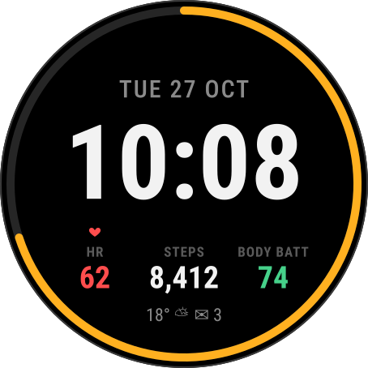
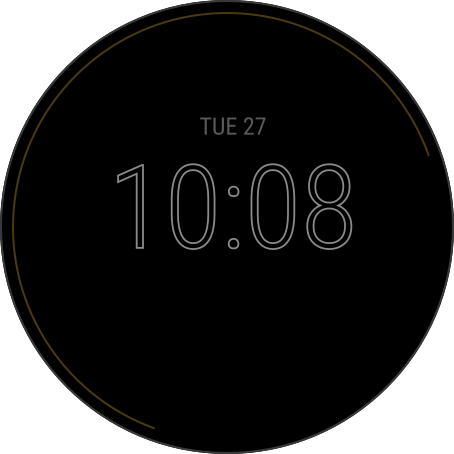
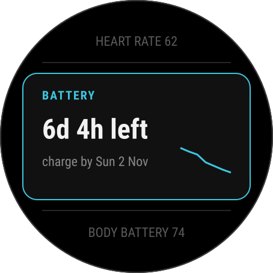
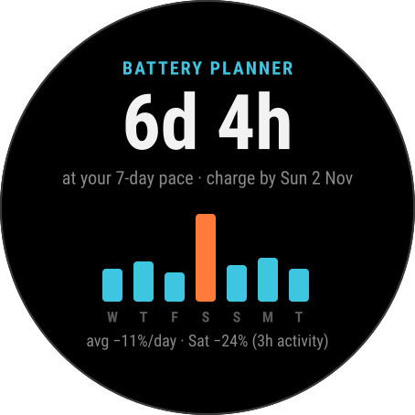
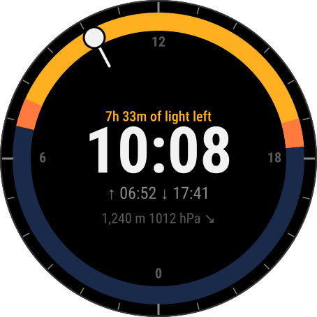
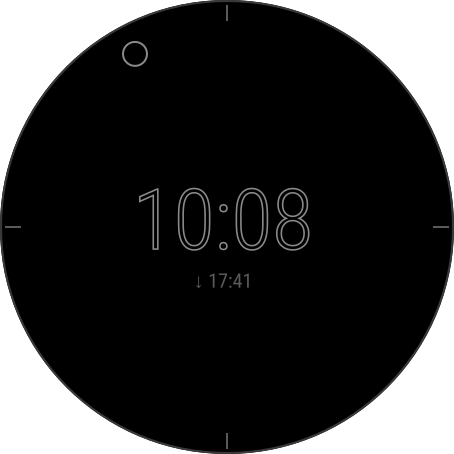
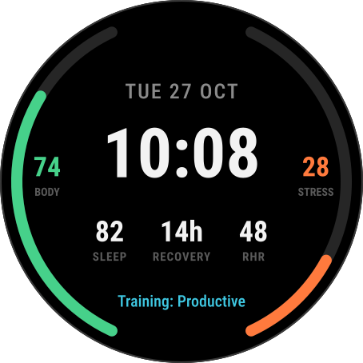
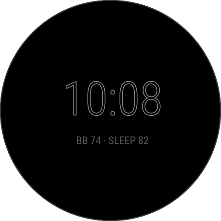
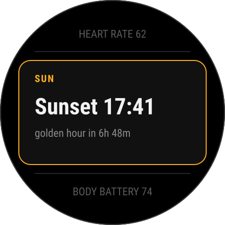
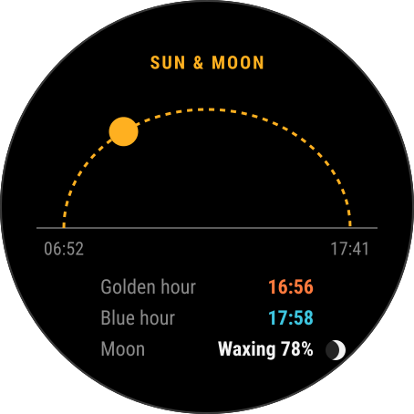

# Designs: first watch faces and glances

Sketches for the first things worth building for the fēnix 8 Pro. Each one was
chosen because it is either something every owner looks at all day (watch
faces) or something the native firmware doesn't already do well (glances).

Mockups live in [`svg/`](svg/) and are generated by
[`mockups.py`](mockups.py) (`python3 designs/mockups.py`). They show layout and
hierarchy at the real 454×454 size, with placeholder data and approximate
fonts.

Confidence markers follow `EXPLORATION.md`: ✅ long-standing API, ⚠️ verify
in the SDK before relying on it.

## Priorities

| # | Design | Type | Value | Effort | Main risk |
|---|---|---|---|---|---|
| 1 | **Field** | Watch face | Everyday face, the thing we'll look at most | S | None. Built in `apps/field/` |
| 2 | **Battery Planner** | Glance + app | Drain history and a charge-by date. Native only shows a current estimate | M | Built in `apps/battery/` |
| 3 | **Daylight** | Watch face | Distinctive 24 h sun dial for outdoor use | M | Built in `apps/daylight/` |
| 4 | **Readiness** | Watch face | Body metrics without opening widgets | M | Built in `apps/readiness/` |
| 5 | **Sun & Moon** | Glance + app | Golden/blue hour and moon phase, offline | S–M | Built in `apps/sunmoon/` |
| 6 | **Night Sky** | Watch face | The real sky overhead: stars, constellations, Moon, planets | M | Built in `apps/nightsky/` |
| 7 | **Horizon** | Watch face | The bezel is the next 12 hours: rain, sunset, next event | M | Built in `apps/horizon/` |
| 8 | **Sun Compass** | Glance + app | A live compass rose with today's sun path across it | S–M | Built in `apps/suncompass/` |
| 9 | **Pocket QR** | Glance + app | Up to six QR codes set up on the phone, shown full screen | S | Dropped 2026-10-31: the owner did not like it; removed from `apps/` |
| 10 | **Sauna and Steam** | Glance + app | Sauna or steam room, round by round, coached against the guidance, a cue by every button | M | Built in `apps/sauna/` |
| 11 | **Today** | Watch face | The owner's own list and nothing else: next sun event, 24 h time, date, moon, heart rate, outside temperature, miles walked, alarms | S | Built in `apps/today/` |
| 12 | **Strata** | Watch face | The Today list set into a field of soil layers from the owner's laser-cut planter: each reading in a clearing the layers part round, clean cut-out time, mineral temperature colour, stones for miles | M | Built in `apps/strata/` |
| 13 | **Rings** | Watch face | Three goal rings open to the right (steps, floors in segments, Body Battery) with their numbers along the curves, the Today numbers down the right side, three colour sets, after a store face the owner picked | S | Built in `apps/rings/` |
| 14 | **Sound Level** | Glance + app | An approximate sound level meter from the watch microphone, with the NIOSH danger range, the day's dose while open, and a cue by every button | S–M | Rebuilt after crashing the watch: one continuous capture per opening, never restarted in the app (2026-10-31); experimental |
| 15 | **Forage** | Watch face | For the beekeeper: whether the bees are flying now, the next good hours to open the hive, the next twelve hours as a strip of comb, and the nectar year along the bezel | S–M | Built in `apps/forage/` |

Considered and dropped:

- **Voice memo (SDK 9.3 mic).** The fēnix 8 already records voice notes
  natively.
- **Smart-home / web dashboards.** These need the owner's own HTTPS server, and
  the store already has good ones. Revisit if there's a specific service to
  talk to.

---

## 1. Field: everyday watch face

 

**Purpose:** the time large and legible, plus the handful of numbers people
check dozens of times a day, with nothing else.

**Layout (active)**
- A ring around the bezel. By default it is a **24-hour daylight dial**: noon
  at the top, night in navy, daylight in the accent colour from sunrise to
  sunset, and a sun marker at the current time, so the shape of the day and
  the light left are visible without a number. Settings switch the ring to
  step-goal progress, battery, or off. (The first cut showed battery with a
  "72% · 6d 4h" readout; dropped, since a watch that lasts weeks doesn't need
  its battery on the home screen.)
- A **signals row** at the top that is empty unless something applies: a
  droplet with the chance when the hourly forecast puts rain at 40 % or more
  in the next 3 hours, a red triangle with "hPa" when the barometer has
  dropped 4 hPa in 3 hours (the storm-alert convention), a red dot when the
  phone is disconnected, and a circle-with-bar for do not disturb.
- Date above the time; very large time in the centre.
- Three slots: **HR · Steps · Body Battery**. Each slot can be set to another
  value in settings: calories, floors, distance, stress, sunrise, sunset, next
  calendar event, recovery time, sleep score, or today's high/low.
- A footer with the **next sun event** only: ▲ 6:52 until the sun is up, then
  ▼ 17:41, then tomorrow's sunrise. One value, not two. While the sun is down
  a small **moon glyph** with tonight's phase sits beside it. Settings switch
  the footer to weather plus notification count, or off.

**Always-on:** hollow time digits, the date in dim grey, the next sun event,
and a 2 px hairline ring (the daylight band and a hollow sun marker).
Everything shifts by up to ±12 px, one step a minute. Lit pixels stay well
under 10 %.

**Interaction:** pressing and holding a slot opens the native widget for
that complication, via `WatchFaceDelegate.onPress` → `Complications.exitTo(id)`
✅ (API). `onPress` is the touch-and-hold event; a plain tap never reaches a
watch face outside the config editor. Needs the `ComplicationSubscriber`
permission. Untested on hardware ⚠️.

**Data**

| Value | Source |
|---|---|
| Battery %, days left | `System.getSystemStats().battery` / `.batteryInDays` ✅ |
| HR | `Activity.getActivityInfo().currentHeartRate` ✅, or the HR complication |
| Steps | `ActivityMonitor.getInfo().steps` ✅ |
| Body Battery | `Complications` body-battery type ⚠️, or `SensorHistory` (needs the `SensorHistory` permission) |
| Weather | `Weather.getCurrentConditions()` ✅ |
| Notifications | `System.getDeviceSettings().notificationCount` ✅ |
| Sunrise, sunset | sunrise/sunset complications (seconds since local midnight, the watch's own figures) ✅, falling back to `Weather.getSunrise/getSunset` with the weather observation position or the last activity location (`Lib.Sun`) |
| Moon phase | synodic-month arithmetic from the clock (`Lib.Moon`), no data needed ✅ |
| Rain ahead | `Weather.getHourlyForecast()` precipitationChance ✅ |
| Pressure falling | `SensorHistory.getPressureHistory` over 3 h ✅ |
| Phone, do not disturb | `System.getDeviceSettings().phoneConnected`, `.doNotDisturb` ✅ |
| Next calendar event, sleep score, recovery, high/low | the matching complications ✅ (calendar is a time string; sleep 0–100; recovery via `ActivityMonitor.Info.timeToRecovery`; high/low from `Weather.getDailyForecast()`) |

**Settings:** accent colour, what the ring shows (daylight dial, step goal,
battery, off), whether the signals row is shown, slot 1–3 contents, the
footer (next sun event, weather and notifications, off), and 12/24 h follows
the system.

**Fonts (measured in the simulator at 454 px):** time `FONT_NUMBER_MEDIUM`
(153 px box), date `FONT_TINY`, values `FONT_SMALL`, footer `FONT_XTINY`, slot
labels a 22 px `RobotoCondensedRegular` vector font. The system fonts are much
larger than the mockup's CSS sizes suggest: `FONT_NUMBER_THAI_HOT` is 210 px.

---

## 2. Battery Planner: glance + app

 

**Purpose:** answer "when do I need to charge?" from actual use instead of a
spec-sheet estimate. This matters on the MicroLED model (10 days vs. 27) and
with always-on enabled.

**Glance:** the time left at your 7-day pace, the charge-by date, and a
sparkline of battery level.

**App:**
- The projection in large type.
- Daily drain bars for the last 7 days. Days well above average are
  highlighted, and annotated with that day's activity time when available.
- The average drain per day.

**How it works**
- A background service on a temporal event (every 30–60 min; the floor is
  5 min ✅) writes `(time, battery%, charging?)` into a small ring buffer in
  `Application.Storage`. 7 days × 24 samples is about 2 KB.
- The projection is the remaining % divided by the median daily drain over
  the last 7 days. Charging spans are excluded.
- Activity annotation comes from `UserProfile.getUserActivityHistory()` ⚠️.

**Risks:** the background memory limit (about 64 KB ⚠️) is fine for this. The
first day after install has no history, so it falls back to
`batteryInDays`.

**Built** as `apps/battery/` (a `widget`, so it sits in the glance loop):
- `BatterySampler` (background, every 30 min) appends `[time, level,
  charging]` to a flat array in `Application.Storage` (`BatteryLog`, newest
  384 samples = 8 days). Select in the app logs a sample right away.
- `BatteryModel` sums the drain between consecutive samples per local day,
  skipping charging spans, level rises and gaps over 3 h. A day with 20 h of
  coverage is complete; the pace is the median of complete days (or a rough
  rate once 3 h of history exist). Time left = level ÷ pace; "charge by" is
  when the level reaches a 10 % reserve. A day over 1.5× the pace is the
  heavy day, annotated with that day's activity time from
  `UserProfile.getUserActivityHistory()` (app only).
- Glance: BATTERY / "6d 4h left" / "charge by Sun 2 Nov" plus a sparkline
  of the level; theme light blue. App: the same in large type, seven bars,
  the pace line. Both fall back to the watch's `batteryInDays` with "watch
  estimate, logging day 1".
- Formatting comes from `Lib.Fmt`, which is glance-safe.

---

## 3. Daylight: 24-hour sun dial watch face

 

**Purpose:** see the shape of the day at a glance: how much light is left and
when golden hour starts. Aimed at hiking, photography and short winter days.

**Layout (active)**
- A 24 h ring with noon at the top and midnight at the bottom. Daylight is an
  amber band from sunrise to sunset, golden hours are orange slices, and night
  is navy.
- A sun marker on the ring at the current time.
- Centre: "7h 33m of light left", the digital time, sunrise and sunset times,
  then altitude and the pressure trend.

**Always-on:** four cardinal ticks, a hollow sun marker, hollow time, and the
next sun event.

**Data**

| Value | Source |
|---|---|
| Sunrise/sunset | `Weather.getSunrise/getSunset(location, moment)` ✅ |
| Golden/blue hour | our own solar-elevation maths (NOAA algorithm, about 60 lines) |
| Location | last known `Position` / `Activity.getActivityInfo().currentLocation` ✅ (no GPS fix from a watch face) |
| Altitude, pressure | `Activity.getActivityInfo()` altitude / ambient pressure ✅ |
| Pressure trend | `SensorHistory` pressure history ✅ (3 h delta) |

**Risks:** the location can be stale after travel. Show "location from
<time>" in settings, and refresh it when any activity records GPS.

**Built** as `apps/daylight/`:
- The dial: navy all round, amber from sunrise to sunset, orange for the
  golden hours (−4° to +6°, so each slice straddles sunrise or sunset),
  24 ticks outside with 0 / 6 / 12 / 18 inside, a white hand and dot at the
  current time. Times come from `Lib.Solar` with `Lib.Location`; with no
  location ever known the watch's own sunrise/sunset (`Lib.Sun`) draw the
  day band and there are no golden slices.
- Centre: "7h 33m of light left" or "sunrise in 9h 12m", the time, the
  sunrise and sunset times with drawn triangles, altitude (m or ft per the
  device setting) and sea-level pressure with a trend triangle when the
  barometer moved 1 hPa in 3 h.
- Always-on: four cardinal ticks, a hollow sun marker, hollow time, the
  next sun event; all shifted each minute by `Lib.Aod`.
- No settings yet. Not done from the sketch: the "location from <time>"
  note.

---

## 4. Readiness: body-metrics watch face

 

**Purpose:** the recovery picture without scrolling through widgets.

**Layout (active)**
- Left gauge: **Body Battery**. Right gauge: **stress**.
- Centre: date and time.
- Tiles: **Sleep score · Recovery time · Resting HR**.
- Footer: training status.

**Always-on:** hollow time and one summary line ("BB 74 · SLEEP 82").

**Data**

| Value | Source |
|---|---|
| Body Battery, stress | `Complications` ⚠️ or `SensorHistory` ✅ |
| Sleep score | Sleep Score complication (SDK 9.2) ⚠️ |
| Recovery time | recovery-time complication ⚠️ |
| Resting HR | `UserProfile` / HR complication ⚠️ |
| Training status | training-status complication (CIQ 4.2+, as a string) ✅ |

**Risks:** HRV status and Training Readiness are the metrics people most want,
and there's no evidence CIQ exposes them. Check the complication list in the
SDK before committing to this face. If they're missing, this face may not beat
the native ones.

**Built** as `apps/readiness/`:
- Sources, from the SDK 9.3 docs: Body Battery and stress are the newest
  `SensorHistory` samples (stress falls back to `ActivityMonitor`); sleep
  score (API 6.0.2), recovery time (minutes) and training status (a string)
  are complications; resting heart rate is `UserProfile.getProfile()`. HRV
  status and Training Readiness are indeed not exposed, so the face shows
  the sketch minus those two.
- The gauges fill upward on both sides (Body Battery clockwise from the
  bottom left, stress from the bottom right), with the number and label
  beside each. Tiles: "82 SLEEP", "14h RECOVERY" (rounded up; "ready" at
  zero, "45m" under an hour), "48 RHR". Footer: "Training: Productive",
  left out when the watch has no status.
- Press and hold on a gauge, a tile or the footer opens the native widget
  (`Complications.exitTo`); RHR opens the heart rate widget, the nearest
  thing.
- Metrics are read once a minute while awake and every five minutes
  always-on, where the update has a power budget. Always-on is the hollow
  time and "BB 74 · SLEEP 82", shifted each minute.
- The simulator supplies values (Body Battery 88, stress 35, sleep score
  15, 5 h recovery, resting HR 60, training "No Result"), so the layout can
  be checked with real-looking numbers.

---

## 5. Sun & Moon: glance + app

 

**Purpose:** times for photographers and campers, fully offline.

- **Glance:** the next sun event and a countdown to golden hour.
- **App:**
  - a horizon arc with the sun's position
  - golden hour (sun 6° → −4°) and blue hour (−4° → −6°)
  - moon phase and illumination
  - stretch goal: moonrise/moonset

**Data:** pure maths on location and time (shares the solar code with
Daylight). The moon phase comes from the synodic-month calculation. No
network.

**Risks:** the native firmware already shows sunrise/sunset, so the value is
in the golden/blue hour and the moon. Keep it small.

**Built** as `apps/sunmoon/` (a `widget`, app name "Sun and Moon" because the
store rejects `&` in names):
- `Lib.Solar` (glance-safe): the NOAA equations for declination and the
  equation of time, `crossings()` for the times the sun reaches any altitude
  (two passes, within a minute of the NOAA calculator), `elevation()`, and
  `day()` for sunrise/sunset (−0.833°), golden hour (+6° to −4°) and blue
  hour (−4° to −6°), morning and evening.
- `Lib.Location`: weather observation point, else the activity's location,
  else the watch's last GPS fix (`Position.getInfo()`, needs the Positioning
  permission but switches nothing on), else the position the app saved.
- Glance: SUN / "Sunset 17:41" / "golden hour in 6h 48m" (or "golden hour,
  ends in 23m"); theme gold. App: the sun on a dotted half-ellipse between
  the sunrise and sunset times (a dim dot under the horizon at night), then
  rows for the next golden hour, the next blue hour, and the moon with its
  phase glyph. Polar days say "No sunset today"; no location ever known says
  "No location yet".
- Moonrise/moonset (the stretch goal) is not done.

---

## 6. Night Sky: the sky overhead as a watch face

**Purpose:** look at the wrist and see what is above you: which stars,
where the Moon is, whether that bright point is Jupiter. Useful on a clear
night out; by day it still shows the sky with the Sun in it, dimmed.

**Layout (active)**
- The bezel is the horizon, the centre is straight up. North at the top,
  east on the **left**: the view you get lying on your back, not a map.
  N / E / S / W just inside a thin horizon ring.
- 345 stars to magnitude 3.6 plus the members of 23 asterisms (Orion, the
  Dipper, Cassiopeia, Cygnus, the Summer Triangle, Scorpius, Leo, Gemini,
  Taurus, Canis Major, Crux, the Pointers, the Square of Pegasus, Boötes,
  the Teapot, Perseus, Auriga, the Little Dipper, Virgo), joined by dim blue
  lines. Size and brightness follow magnitude; the faintest are single
  pixels. By day everything is dim and the Sun is drawn in amber.
- The Moon with its phase glyph; Venus, Mars, Jupiter and Saturn with a
  letter each.
- The time on a black backing in the middle (that hides the zenith, the
  least interesting part), the date under it.

**Always-on:** the twenty brightest stars up right now as single dim dots,
and the hollow time, shifted each minute.

**Data:** `Lib.Sky` (sidereal time, equatorial to horizontal, and the Sun,
Moon and planets from Schlyter's low-precision elements, about a degree)
with `Lib.Location`. The catalogue is generated by `designs/gen_stars.py`
from the Yale Bright Star Catalog into `apps/nightsky/source/Stars.mc`
(J2000; precession since is a third of a degree, ignored).

**Cost:** placing the whole sky takes 6 ms in the simulator; the always-on
update looks at the brightest 80 stars only and draws in under 30 ms.

**Not done:** a settings toggle for the constellation lines; star names on
a long press; the Milky Way.

---

## 7. Horizon: the next twelve hours on the bezel

**Purpose:** one glance answers "what's coming": dry until three, meeting
at four, dark by six.

**Layout (active)**
- An ordinary 12-hour dial, but the bezel is the twelve hours ahead, one
  segment per hour starting at the current hour: dark grey by day, navy
  once the sun is down, and blue where rain is likely (three shades: 20, 40
  and 60 % chance). A white dot on the ring marks now, like an hour hand.
- A triangle just inside the ring where the sun sets (orange) or rises
  (amber) if that is within twelve hours; a white diamond where the next
  calendar event is.
- Centre: date, time, the rain outlook in words ("rain from 15:00, 70%",
  "rain now, 80%", "no rain in the next 12 h", "no forecast"), then the
  temperature, the sun event and the event time with the same glyphs.

**Always-on:** a 2 px hairline showing only the rain hours in dim blue, a
hollow dot at now, hollow time, the next sun event; shifted each minute.

**Data:** `Weather.getHourlyForecast()` (precipitation chance per hour, 12
to 13 hours ahead on the watch), `Lib.Solar` with `Lib.Location` for the
day/night tint and the sun marker (the watch's own sunrise/sunset when no
location was ever known), the calendar complication's "16:00" string parsed
for the diamond, `Weather.getCurrentConditions()` for the temperature.
Everything is worked out in `HorizonModel.build()` from plain numbers, so
the tests feed it a synthetic day.

**Not done:** a mockup in `mockups.py`; the event title (the complication
only gives its time); a rain threshold setting.

---

## 8. Sun Compass: a compass rose with today's sun across it

**Purpose:** answers "where will the sun be?": which way to point the
camera, which side of the valley the campsite should be on, when the
evening sun reaches the terrace. Hold the watch flat and the rose turns
so the way you face is at the top, with the whole day's sun path drawn
across the sky inside it.

**Layout (app)**
- Rim: ticks every 10°, longer every 30°, and the letters N (amber), E, S
  and W inside them; all turn with the heading. A fixed amber wedge at 12
  o'clock marks the direction you face.
- Inside, the sky seen from above: the horizon is a dim ring and straight
  up is the centre. Dim amber dots mark the sun at every full hour it is
  up, with every third hour labelled in small grey figures (the label sits
  away from the centre, or towards it when the dot is near the horizon,
  and is dropped while the sun covers that dot); an amber ▲ on the ring
  is sunrise, an orange ▼ sunset. The sun right
  now is an amber disc with a hairline out to the ring so its bearing can
  be read off the ticks; below the horizon it becomes a hollow circle on
  the ring at its bearing.
- Centre: the heading ("213° SW") and the next sun event with its bearing
  ("sets 17:41 at 232°", "rises 7:12 at 108°", "up all day").
- Glance: COMPASS, then "Sun 148° SE" or "Sun below horizon", then
  "31° up, sets 17:41 at 232°". No sensor runs in the glance.

**Data:** `Sensor.getInfo().heading` (true north, radians; needs the
Sensor permission), polled four times a second while the app is on screen
alongside the 1 Hz sensor event, and smoothed halfway to each reading so
the rose glides. `Lib.Solar.altAz` (NOAA) gives the sun's altitude and
bearing now, at every full hour of the day and at sunrise and sunset, from
`Lib.Location`. Once the sun has set the path shown is tomorrow's.

**Not done:** a mockup in `mockups.py`; the moon's bearing; a day picker
for the path. Magnetic declination is not
needed: the watch reports a true-north heading.

---

## 9. Pocket QR: dropped

Up to six QR codes set up in the Connect IQ app, shown full screen for
scanning. Built, then dropped on 2026-10-31 because the owner did not
like it; the code is in git history.

---

## 10. Sauna and Steam: rounds, recovery, coaching, and a watch that says what its buttons do

**Purpose:** a sauna or steam-room visit tracked round by round without
fiddling with a wet watch, and coached against the published guidance.
START picks the kind. Each kind has its own plan (targets, rounds, a heat
cap, weekly goals, door sensitivity), its own history and weekly count,
and the same screens and the same depth of coaching. Temperatures follow the
watch's unit unless the setting picks one. The idea comes from the
store's "Sauna App" (manual LAP, four screens, a paid unlock); the
owner's own ask was cueing on what the buttons will do, then a second
kind of room with coaching for both.

**Layout (app)**
- Button cues on every screen: a short arc on the bezel beside each
  button with a word just inside it. START or MENU at two o'clock; EXIT,
  IN or OUT at four; the names of the previous and next screens at nine
  and eight. The angles are where Garmin's own button hints sit on this
  family, read from the device personality files: 58°, 123°, 270° and
  237° clockwise from twelve, the same on all three devices.
- Live: a band across the top ("SAUNA · ROUND 2 OF 3" in ember, "STEAM ·
  ROUND 1 OF 2" in blue, "BREAK · AFTER ROUND 2" in steel grey, "READY · SAUNA"
  in grey, "WATCH HOT · 122°" in red), the phase timer in big digits, the
  coach's line under it, "total 38:10 · heat 24:00 · out 14:10" in small
  grey, and the heart rate, breathing and watch temperature along the
  bottom with the unit on the label. Idle, "Press START" over the last
  visit and this week's count.
- Rounds: time in heat and out, then a row per round: length, max heart
  rate, the one-minute fall; the watch's hottest reading at the foot.
- Chart: the last finished round's heart rate from the door to two and a
  half minutes after it, in the kind's colour and then blue, with the
  peak, the one- and two-minute falls and the usual fall for that kind.
- Visits: the last seven, dates coloured by kind (ember, blue) with a
  legend.
- Glance: "SAUNA · STEAM", then "Steam room · 2 rounds · 24 min", then
  "Week: 1 of 3 steams · 24 of 40 min" against that kind's plan.
- START when idle opens the selector: Guided sauna and Guided steam
  (each with its plan under it, "15 min × 3 · cool down 15"), Free sauna
  and Free steam ("in and out as you like"), and Clear visits. A free
  session records exactly the same data, measures the same recovery and
  keeps the heat guard, but has no targets, nags or cap; its coach line
  just says "Free session · out when you like" and "Cooling down · in
  again when ready". The pause menu switches a visit between guided and
  free from that moment on, and the FIT session carries a Guided field.
- Ending a visit: the START cue reads END while recording; START opens
  Save / Resume / Switch / Discard with Save first, and the coach's last
  line is "Plan done · START to save". Long presses belong to Garmin
  (hold START is voice commands, hold BACK is recent apps).
- Touch: a tap near a cue on the bezel does what that button does, so
  the corners work as soft buttons on the simulator and the watch alike;
  taps in the middle of the screen do nothing (wet fingers).
- Launcher icon: ember heat waves on the left, blue drops on the right.
- Demo, from the Start menu: a made-up sauna visit (two rounds done, four
  minutes into the second break, a recovery, a heart-rate trace, live
  readings) over six made-up visits in the history, so every screen can
  be looked at without a sauna. Nothing is recorded or stored; End demo
  in the pause menu clears it.
- Sized for a hot room: a title band on every page in the page's colour
  (ember or blue in the heat, steel grey on a break, dark grey for
  Rounds, Recovery and Visits), page dots at the foot, the readings at
  an eighth of the screen height, the coach line and table rows at a
  sixteenth. Tables and the chart stay inside the area the cue words do
  not reach, and each cue word sits on a black patch so it stays
  readable wherever content meets the edge.
- The app is a watch-app with a glance, not a widget: widgets may not
  record activities (`ActivityRecording.createSession` is for watch
  apps, glances and background only), and a visit started in a widget
  died at once.

**Coaching** (the line under the timer, with a buzz at each turn)
- Arrival: "Drink, shower, then go in", then "Walk in when ready" (or
  "LAP when you go in" with the automatic door off).
- In the heat: a countdown "4:30 left"; "Time to cool down" at the round
  target (one long buzz); "Over 20 min · come out" once a minute past the
  longest round (two long); "That's 45 min of heat · come out" when the
  rounds add up to the visit's cap (three).
- Out: "Drink some water" for the first 45 s; "Cool down 7:30 more" until
  the break is at least the plan's and never shorter than the round
  before it; then "Ready for round 3" (double buzz) or, after the last
  planned round or the cap, "Plan done · shower, then save" (triple).
- A minute after each round's peak: "Fell 34 in a minute · usual 29",
  against this kind's earlier visits (a short buzz).
- "Watch hot, take it off" beats everything while the heat guard is on.
- Heart-rate rules, each with its own switch in a "Heart-rate coaching"
  settings group, taken from the occupational heat-strain criteria
  (ACGIH, used by NIOSH and OSHA) because no clinical body publishes a
  sauna limit: "Heart rate 158 · come out" after a full minute over the
  ceiling, once a minute while it lasts (the ceiling setting, or 180
  minus the age in the Garmin profile, or the top of zone 4; off without
  any); "Not recovered · 125 bpm, cool down longer" when, a minute after
  leaving, the rate is still over 110, which adds five minutes to that
  break; and "Stand up slowly" for the first twenty seconds of every
  break, because blood pressure sags after heat. The rules run in guided
  and free sessions alike. The group's description says plainly that it
  is not medical advice and to switch the rules off on beta blockers.
- Logged, not coached on: the breathing rate and Garmin's stress score
  every second, Body Battery at the start and the end of the visit (in
  the file, the history row and the Rounds screen), and, as an
  experiment with its own switch, heart-rate variability as RMSSD over
  each minute from the wrist's beat-to-beat intervals (shown on the
  Chart screen when known). Core temperature and blood pressure, the two
  numbers that matter most for safety, are not measurable on the wrist
  and the app does not pretend otherwise.
- The plans, all settings, grouped by kind on the phone: sauna rounds of
  15 min, nag at 20, cool down 15, 3 rounds, 45 min of heat, 4 visits
  and 60 min a week; steam rounds of 12, nag at 15, cool down 12, 2
  rounds, 30 min of heat, 3 visits and 40 min a week, and door rates
  about half the sauna's because a steam room is only a few degrees
  above skin. The sources: the Finnish cohort studies (4 to 7 sessions a
  week, over 19 min each, lower cardiac mortality, observational), the
  ACSM-cited guidance (rounds of 15 to 20 min dry, 10 to 15 in steam,
  about 30 min of heat in a visit, water before and after, no alcohol),
  and Finnish practice (cool down at least as long as the round, never
  skip the last one).

**Behaviour**
- LAP (BACK) marks the door by hand. The thermometer marks it on its own
  when the watch warms the kind's enter rate above its coolest reading of
  the last minute, or cools the leave rate below its hottest, never
  within 90 s of the last change or three minutes of a button press;
  the sensitivity setting scales both rates. Two buzzes in, one out.
- Recovery: the peak in the half minute after leaving, then the fall one
  and two minutes after that peak, per round and averaged.
- Heat guard: a list setting, 113 / 122 / 131 °F (45 / 50 / 55 °C) or
  off; the band turns red and the watch buzzes once a minute.
- Saved as a Meditation activity (a setting switches to a generic one)
  named Sauna or Steam room: a lap per phase, the watch temperature and
  the phase every second, the recovery on each break lap, the totals and
  the kind on the session, through FitContributor. Thirty visits stay on
  the watch, each with its kind.

**Data:** `Sensor` for the heart rate, `Sensor.Info.temperature` at 1 Hz
and the beat-to-beat intervals through `registerSensorDataListener`,
`SensorHistory` for the temperature fallback and Body Battery,
`ActivityMonitor`'s respiration rate and stress score, `UserProfile` for
the birth year, `Fit` and `FitContributor` for the file (eighteen
developer fields, each created on its own so a refusal drops only that
one). Settings in four groups: the watch (unit, automatic door, door
sensitivity, hot warning, activity type), heart-rate coaching, the sauna
plan, the steam-room plan.

**Not done, to learn on a watch:** how the fēnix 8's thermometer really
moves in each room (the FIT file logs it every second so the rates can
be tuned; a steam room may need LAP), whether `Sensor.Info.temperature`
is populated at all in a device app, how the optical heart rate copes
with sweat, the cues and the unit by eye, and whether the Connect IQ app
shows the three settings groups. Steam is the harder room for the
hardware: 110 to 120 °F at full humidity sits at the watch's 113 °F
rating, and steam gets past seals over time. Not built: cold-plunge
phases (fēnix 8 owners report crashes in water under 8 °C), a breathing
pacer during breaks.

---

## 11. Today: the owner's list on one face

**Purpose:** the first face built from a list the owner wrote down, not
from what the platform happens to allow. It shows exactly these things and
nothing else, with no settings:

- when the next sun event is and whether it is sunrise or sunset; once
  the sun is up, the time of sunset
- the time in 24-hour form
- the date: the day of the week and the day of the month
- the moon phase
- the heart rate
- the outside temperature
- how far the owner has walked today, in miles
- any alarms that are set

**Layout (active)**, top to bottom
- An alarm clock and the number of alarms set, only when there is one.
  The watch tells apps the *count* of alarms, never their times
  (`EXPLORATION.md` 10.1), so there is no "06:30".
- The next sun event: "▲ SUNRISE 07:12" until the sun is up, then
  "▼ SUNSET 17:41", then tomorrow's sunrise. Amber for sunrise, orange for
  sunset, the time in white. "NO SUN TIMES YET" when the watch has
  neither its own sunrise/sunset nor a location.
- The date, "THU OCT 29", in grey.
- The time, very large, always "07:05" whatever the 12/24 h setting says.
- Three columns, a small label over a condensed bold value: **HR** in
  red, **OUTSIDE** (the weather temperature in the watch's unit: "52°F" or "11°C"), and
  **MILES** or **KM** (distance walked today to one decimal; the unit is
  the label so the value stays short).
- The moon drawn as it is tonight, with the name of its phase beside it
  ("Waxing gibbous").

**Always-on:** the next sun event, the hollow time and the date, all dim
and shifted each minute by `Lib.Aod`.

**Interaction:** press and hold on the sun line opens the sunrise or
sunset widget, on the date the calendar, on a column the heart rate,
weather or steps widget (there is no distance widget).

**Data**

| Value | Source |
|---|---|
| Next sun event | `Lib.Sun`: the sunrise/sunset complications, else `Weather.getSunrise/getSunset` at the weather observation position. The face declares `Positioning`, since without it that position is null on a watch |
| Time, date | `System.getClockTime`, `Gregorian.info` (`Lib.Fmt.clock24`) |
| Moon | `Lib.Moon.phase` and `Lib.Moon.name`, synodic arithmetic, no data needed |
| Heart rate | `Activity.getActivityInfo().currentHeartRate`, else the newest valid `ActivityMonitor.getHeartRateHistory` sample |
| Outside temperature | `Weather.getCurrentConditions().temperature`, null until the phone syncs, shown in the watch's unit (`Lib.Fmt.temperatureWithUnit`) |
| Distance today | `ActivityMonitor.getInfo().distance` (cm) through `Lib.Fmt.distanceValue` and `distanceUnit` |
| Alarms | `System.getDeviceSettings().alarmCount` |

**Built** as `apps/today/`: `TodayView` (the two layouts), `Sources`
(each value as text), `TodayDelegate` (press and hold). The slow readings
are taken once a minute; the heart rate is read on every draw. Added to
`Lib` for it: `Fmt.clock24`, `Fmt.distanceValue` / `distanceUnit`, and
`Moon.name`. Drawing the face takes about 140 ms awake and under 100 ms
always-on in the simulator, and the app uses about 20 KB.

**Not done:** a mockup in `mockups.py`.

---

## 12. Strata: the Today list set into the planter's layers

**Purpose:** the same information as Today, but as one picture: the
"Strata" pattern from the owner's laser-cut wall planter (good-tools,
`tools/wall-planter`, pattern *Strata, soil layers and pebbles*,
Variation 7) covers the whole face, and each reading sits in a clearing
the layers part round, like water round a stone. The time is the largest
part.

**How it got here:** the first version drew the time with the layers
themselves (bold, dense pieces of the lines on the digits' strokes) and
put haloed labels over the field. The owner found it messy: the hatched
digits, the heart-rate line across the face, the "SUNSET" label, the
loose readings. The redesign (2026-10-30) was reviewed over four rounds
by a team of four adversarial reviewers (typography and elegance;
spacing, balance and feng shui, measured; nature and art direction; a
skeptic for glanceability), on renders with sample readings from
`designs/preview_strata.py` and then on the watch in the simulator.

**The field**
- `designs/gen_strata.py` is a line-for-line port of the planter's
  generator (the same value noise, hash and random generator, in pixels
  instead of millimetres) and writes `apps/strata/source/Field.mc`:
  layers across the disc, each the layer above plus a gap the noise
  squeezes or opens, every fourth marked as the accent, and pebble slots
  where the layers open up (never under the time or in a clearing). The
  watch cannot run the noise itself (a face that tried tripped the
  watchdog), so the table is generated offline like Night Sky's stars,
  and `Layers` only scales it to the screen.
- **Clearings** (`ISLANDS`, each an `Island`): one pool for the sun line
  over the date (narrow above, wide below, easing out over about twice
  its height so the layers slope in like a valley), one for the row of
  readings (flat under the numbers and units, and over them a low floor
  with a soft mound rising to each cue, so the layers dip only a little
  between the columns), and a raised-cosine bump hugging the moon. Each
  is fitted to the measured ink of what it holds, with the widest values
  (a "MON DEC 28" date, 180 bpm, 12.4 mi) and a 0.012 margin, so the
  layers come right up to every reading (owner, 2026-10-30: "make the
  strata go up to all of those different complications a little more").
  Round each, the layers are levelled part of the way, then parted: every
  layer keeps to its side and moves away by the clearing's height, less
  the further off it is, so they gather round the rim and relax away
  from it without crossing. The readings' clearing reaches down only
  briefly so it does not push its layers into the moon. Any layer still
  touching a clearing is cut there, so a layer may come in pieces; the
  ends left read as layers pinching out against a stone. The script
  prints how many samples remain in each clearing (0). Tried and
  dropped: fully levelled clearings (they read as boxed panels), one
  clearing for the readings and the moon together (a black funnel), and
  laying stray lines along a clearing's edge instead of cutting them
  (deep notches between the columns).
- Always-on gets its own few layers (every eighth), parted only round
  what it shows, so they run on under the time.
- The field is drawn into a full-screen bitmap in the graphics pool
  (3 MB on the fēnix 8, apart from the face's 128 KB) sixteen layers per
  frame, redrawn only when its colours change; a watch face gets only a
  few thousand operations per update before the watchdog kills it.
- monkeyc's type checker overflows its stack on one long array literal,
  so the samples go in chunks of a thousand (`Field.chunks()`).

**How the information shows**
- **Time:** RobotoCondensedBold, 0.31 of the width per em, warm white
  (`#F2ECE2`), cut out of the layers by a 3 px black keyline. (Sizes here
  are ems, as the preview's Pillow fonts take them; `getVectorFont`
  sizes a font by its whole height, about 1.17 ems, so the view asks
  for 1.17 times each.)
- **Sun:** the next event's time on the centre line in cream, the sun
  half risen on a horizon to its left with a chevron over it (up for
  sunrise, down for sunset), no word; a bell to its right while an alarm
  is set (the watch gives the count only).
- **Date:** under it, RobotoCondensedRegular 0.086, cream.
- **Readings:** four slots at 0.186 / 0.391 / 0.596 / 0.801, each set in
  the phone app to any of ten kinds (`Readings`), a filled cue over each
  number: outside temperature (thermometer in the temperature's colour),
  chance of rain (cloud with two drops), heart rate (rosehip heart),
  distance (dotted trail to a map pin), Body Battery (green bolt),
  elevation (two peaks), humidity (drop), wind (three gusts, the outer two
  curled), watch battery (grey battery), steps (footprints; 12,345 shows
  as 12.3k). Defaults: temperature, rain, heart rate, distance. The
  number is cream bold (0.060 em), centred under its cue; the unit small
  and grey, hung off its right. The readings' clearing fits the widest of
  any kind in every slot. The team checked every cue is distinct (no two
  alike in shape or colour) and of even weight.
- **Moon:** at the foot, lit as tonight in a dark stone grey with a pale
  rim, the phase in mixed case in it ("Waning / Gibbous").
- **Day and night:** the earth layers are brown by day, graphite by
  night (day while the next sun event is sunset).
- **Outside temperature:** the accent layers take its colour at 65 %, in
  mineral tones: glacial slate below 25 °F, lichen, moss, ochre,
  terracotta, red clay at 100 °F; graphite-blue at night whatever it is.
- **Miles walked:** from the first mile, a dark stone turns up in the
  layers for every quarter mile, scattered.

**Settings** (`resources/settings`, `Palette`). The phone app only edits
settings for faces installed from the store, and the fēnix 8 shows no
app settings menu for a face; it has its own watch face editor instead
(`resources/configs/watchface.xml`, below). The full set here is for the
phone, the simulator and the tests:
- **Strata color:** Soil (brown by day, graphite by night; the default),
  Clay (terracotta), Moss (olive, deep teal at night), Slate (blue-grey,
  deep blue at night), Sand (pale sandstone). All about as bright, at
  least ΔE 12 from each other by day and by night.
- **Every fourth layer:** the outside temperature (the default; at
  night the strata half way to moonlight), tone on tone (a paler
  strata), or Ochre, Lichen or Ember (at 80 % by day, 70 % at night, so
  each holds its own on any strata).
- **Time color:** Bone (the default), the accent's colour, or Sandstone.
- **Time style:** Filled (the default) or Outline (3 px, 2 px on the
  416 px screen; lights about 80 % fewer pixels for the digits). The time
  colour goes to the fill or the outline.
- **First to fourth reading:** any of the ten kinds above.
- **Night colors after sunset** and **a stone for every quarter mile**,
  both on by default.
`python3 designs/preview_strata.py out.png day 454 strata=1 accent=4`
renders any combination.

**On the watch** (Watch Face → Strata → Customize, the fēnix 8's own
editor, `resources/configs/watchface.xml`, read by
`StrataView.readEditor` over the properties): the **style** is the time,
filled or in outline; the **accent colour** picks the strata (Soil, Clay,
Moss, Slate, Sand); the **data colour** is the time's colour (Bone,
Sandstone, Ochre, Lichen, Ember); **data 1 to 4** are the four readings,
each one of temperature, weather (shown as the chance of rain), heart
rate, steps (shown as the miles walked), Body Battery, altitude or
battery. The editor only offers Garmin's own complication types, so
humidity, wind and the step count stay phone-only, and so does every
fourth layer's colour (it follows the temperature).

**Always-on:** its own layers dim, the time in outline, the sun line and
the date in grey, the moon's lit limb; shifted each minute by `Lib.Aod`,
about 6 % of pixels lit.

**Interaction:** press and hold on the sun line, the date or a reading
opens the matching widget.

**Previews and samples:** `python3 designs/preview_strata.py out.png
[day|night|aod] [454|416]` (needs Pillow) draws the face from the same
field and layout with sample readings. `sample.jungle` builds the same
readings into the face for the simulator, whose own readings are mostly
empty: `CIQ_JUNGLE="monkey.jungle;sample.jungle" scripts/build.sh strata
fenix847mm`.

**Not done:** a settings choice of seed ("New variation" on the planter)
would need the table for each seed.

---

## 13. Rings: three goal rings and the day's numbers

**Purpose:** the store face the owner pointed at (three screenshots,
one per colour set), with the Today list in it.

**Layout (fractions of the width)**
- Three rings 0.062 wide at radii 0.455, 0.375 and 0.295 run up the
  left side, the outer one close to the bezel, so the rings fill most of
  the face (the owner asked for bigger than the store face). Their lower
  ends line up on a vertical 0.07 left of the centre, just left of six
  o'clock; their upper ends stagger at 38°, 30° and 20°
  clockwise from twelve, so the outer one reaches furthest. Each fills
  clockwise from its lower end in its colour over a track of the same
  hue at about a third of the brightness, with round ends: steps
  against the step goal outside, floors against the floors goal in the
  middle (one square-ended segment per floor, a plain ring past 30),
  Body Battery inside.
- Each ring's number is written along its own circle past its lower
  end, in its colour, with `drawRadialText`, after an icon straight
  below the centre: the miles walked after footprints (a yellow star
  once the step goal is met), the floors after stairs, the Body Battery
  after a bolt.
- The right column, values right-aligned at 0.80 in BionicBold at 0.088
  of the width with an icon at 0.862: the moon's phase glyph, the heart rate, the date (an alarm clock
  with the count when alarms are set), the time in 24-hour form in
  BionicBold at 0.3 of the width in the theme's colour, right edge at
  0.905, the next sunrise or sunset with a sun-on-the-horizon icon and
  an arrow, the outside temperature with a thermometer.
- Setting **Colors**: Sunset (blue, orange, yellow, orange time), Berry
  (magenta, red, orange, magenta time), Forest (green, sky, blue, sky
  time), from the three screenshots.

**Always-on:** the rings' fills as 2 px hairlines at a quarter of their
colour, the hollow time, the date and the sun event in dim grey,
shifted each minute by `Lib.Aod`.

**Interaction:** press and hold on a ring (hit by its radius and angle)
opens steps, floors or Body Battery; on a row, the matching widget.

**Data:** `Goals` (`ActivityMonitor.getInfo()` steps, goal, floors,
goal; the newest `SensorHistory` Body Battery sample) and `Lib.Daily`.

**Not done:** a mockup in `mockups.py`; seconds beside the time (the
first screenshot has them; not on the owner's list); the moon's phase in
words (the column has no room left of the inner ring's end).

---

## 14. Sound Level: the room in decibels, and how long it is safe

**Purpose:** a sound level meter on the wrist, now that SDK 9.3 opens
the microphone to device apps. Is this bar too loud, is the workshop
dangerous without ear defenders, how long can the kids stay at the
concert. The owner liked the idea on 2026-10-29 and asked on 2026-10-30
for "a range showing whether it's too loud or dangerous for people".
The watch microphone is not A-weighted and not a calibrated meter, so
the number is approximate: the app says so, and a calibration offset
lines it up with a phone meter.

**Layout (app)**
- Button cues on every screen, drawn by `Lib.Cues` at Garmin's own hint
  angles (shared with Sauna and Steam): MENU at two o'clock, EXIT at
  four, and one page word: TREND beside DOWN on the live page, LIVE
  beside UP on the trend page, the other side blank (both buttons still
  wrap). While calibrating: RESET, DONE, +1 and −1.
- Live: a grey band "SOUND LEVEL" (or "DEMO"), the level in big digits
  (a quarter of the screen high) coloured by its band (green under 70,
  amber to 85, orange to 100, red past it), the band's name with the
  verdict in front once it matters ("Conversation", "Busy traffic", "Too
  loud · hearing risk", "Dangerous · loud venue", "Pain · leave now"), a
  thick bar from 30 to 130 dB across two thirds of the screen filled in
  the bands' colours up to the level with the 70, 85, 100 and 120 lines
  marked, NIOSH's daily limit at that level ("No daily limit", "NIOSH
  limit 15 min", "Under 30 s", "Leave now"), then "max 94 · avg 71 ·
  4 min" and "dose 12% while open" in grey (the owner asked on
  2026-10-31 for a smaller number, a bigger bar and bigger text at the
  foot). "Listening" with what is going on under it ("starting the
  microphone", "waiting for sound") until the first level; the number
  dims and the same status replaces the verdict when windows stop. When
  the microphone stops sending sound it is left alone and the screen
  says "Press BACK, then open it again"; a message when there is no
  microphone or no usable format.
- Past the microphone's range (below): the number in red with a "+",
  "at least 89 dB · too loud to measure", "NIOSH limit under 3 h 10",
  and from then on "max 89+" and "dose at least 2.1%".
- Trend: the last two minutes, one point a second, coloured by band,
  with the 70, 85 and 100 lines across the chart.
- Calibrate (from the menu): the live number again with "offset 90 dB"
  under it; UP and DOWN move the offset a decibel, START resets it to 90,
  BACK keeps it. Written to the Calibration property once, when
  calibrating ends (not on every press), so the phone shows the same value.
- Menu: Demo (a made-up two minutes from a quiet room to a concert, and
  a live level that keeps walking them; like the real microphone it
  reads no higher than its range, so the concert shows as too loud to
  measure), Calibrate, Clear session.
- Glance: "SOUND LEVEL", "72 dB · Busy traffic", "4 min ago · while the
  app was open"; "Open to measure" before the first reading.

**The danger range** (sources at the end): NIOSH's recommended exposure
limit is 85 dBA for 8 hours a day with a 3 dB exchange rate, so every
3 dB more halves the time: 88 dB 4 h, 91 dB 2 h, 94 dB 1 h, 97 dB
30 min, 100 dB 15 min, 103 dB 7.5 min, 110 dB 1.5 min, 115 dB under
30 s. Levels under 80 dB do not count towards the dose. WHO calls 70 dB
averaged over 24 h safe; about 120 dB is the threshold of pain. The
bands: quiet under 40, calm to 55, conversation to 70, busy traffic to
85, hearing risk to 100, loud venue to 120, pain past it. The dose is
NIOSH's daily dose, accumulated only while the app is open and the
microphone runs, and the screen says "while open".

**Maths** (`SoundMeter`, pure, fed by the tests): a window is 16-bit
little-endian LPCM; the RMS of every fourth sample gives dBFS as
20·log10(rms/32768) (a full-scale sine is −3 dBFS); the offset turns
that into dB. The shown level settles over a second; the peak is the
loudest window; the average is by energy (10·log10 of the mean of
10^(L/10)), not by decibel; the buzz fires when the smoothed level rises
past 85 (short) or 100 (long), with 2 dB of hysteresis and at most once
every 15 s per line. A WAV header at the start of a window is parsed
("RIFF", "WAVE", then chunks to "data"), so a header with extra chunks
is skipped whole rather than read as a spike. The microphone's first
half second after every start is thrown away (start transient, gain
settling), and the first level shown is the energy average of the next
full second, so the number opens on the room rather than on a spike
that then falls (the owner's first report from the watch, 2026-10-31).

**The microphone's range:** dBFS cannot go above 0, so with the offset
at 90 the meter cannot read above about 90 dB: a 105 dB concert would
read 90 and claim hours of safe listening. So every window also keeps
its loudest sample, and when samples reach the end of the range
(|v| ≥ 32000) for half of the last second the level is shown as a
floor, not a reading: "at least 89 dB · too loud to measure", with the
limit as an upper bound and the dose as a lower one. A single clipped
window (a clap) does not count. Whether the watch's microphone clips
or compresses loud sound has to be checked against a phone meter.
**Platform:** a watch-app with a glance (the microphone is allowed for
device apps and audio providers only). `Audio.Capture` with
`CONTAINER_WAV`, `CODEC_LPCM`, mono, at the lowest rate the watch
accepts (the fēnix 8 refuses 8 kHz), in windows of 2048 bytes with
`WINDOW_FILLED_CONTINUE`, no filters so the levels stay honest. **Why
one continuous capture (from the watch, 2026-10-31):** every build that
stopped and started capture again and again (one-shot windows started
from `onComplete`, a restart after a stall) rebooted the whole watch, a
firmware trap with nothing in `CIQ_LOG`, and a restart never brought
the sound back while closing and opening the app did. So `SoundMic`
initialises and starts capture once per opening and stops it once on
exit; menus, the demo and calibrating only ignore the data. The
callbacks note what happened and hand the window on, and never print,
touch the microphone or throw; the microphone is touched only from the
one-second tick, which logs what the callbacks noted. A capture that
sends nothing for four seconds is stopped once and left alone with
"Press BACK, then open it again". The screen redraws at most four times
a second whatever the window rate, and the tick catches its own faults.
RMS is taken about the window's mean, so a bias is not sound. Capture
is foreground only. Nothing is kept but the last reading for the
glance, timed when its sound came. Settings: the calibration offset
(50 to 130, default 90) and the buzz.

**Not done, to learn on a watch:** how long a capture keeps delivering
windows on the fēnix 8 (it has stalled after a few minutes), the offset
that matches a phone meter, what the microphone does with loud sound, how the wrist and a sleeve change the reading, and
battery while the microphone runs. Not built: A-weighting, octave bands,
a log of readings.

**Sources:** NIOSH, *Criteria for a Recommended Standard: Occupational
Noise Exposure* (1998), 85 dBA REL, 3 dB exchange rate, dose formula;
WHO, *Guidelines for Community Noise* (1999), 70 dB LAeq 24 h; CDC/NIOSH
*Noise and Hearing Loss* pages for the 120 dB pain and the everyday
examples; Connect IQ SDK 9.3.0 `Audio` module docs and the Core Topics
"Audio" page.

---

## 15. Forage: are the bees flying, and when can the hive be opened

**Purpose:** a face for a beekeeper. One glance answers the two questions
the weather app makes you work out yourself: are the bees out right now,
and when today is a good time to open the hive. It is built from the
owner's own day (they keep bees), not from what the platform allows,
and it keeps the Today basics: 24-hour time and the date.

**Layout (active)**, top to bottom
- The date, "SAT OCT 31", in grey.
- The time, very large, always 24-hour, in warm white (`#F2ECE2`).
- **The verdict:** a small bee and one phrase in honey amber, then the
  outside temperature in the watch's unit: "BEES FLYING 61°F". The other verdicts
  are grey: "TOO COLD TO FLY 48°F", "RAIN, BEES HOME", "TOO WINDY 22 MPH",
  "NIGHT, BEES HOME", and "NO WEATHER YET" until the phone syncs. On a
  sunny winter day of 50 to 54 °F it says "CLEANSING FLIGHTS".
- **The hive window:** "open the hive 11:00-14:00", the first run of good
  hours in the forecast; "open the hive now, until 14:00" inside one;
  "no hive weather in 12 h" when there is none.
- **The comb:** the next twelve hours as a strip of twelve hexagonal cells
  that zig-zag like real comb, with the hour in each and the current hour
  outlined in cream:
  - capped (pale wax, with a cap rim): a good hour to open the hive
  - honey (deep amber): the bees are flying
  - an empty cell: the bees stay home (cold, windy or dark)
  - an empty cell with a blue drop: rain
- **The beekeeper's year** along the bottom bezel, January at the left:
  a grey track with the nectar flows on it (the spring main flow in wax,
  clover and the fall flow in honey) and a cream dot for today. Above it,
  the season's name: "MAPLE AND WILLOW", "FRUIT BLOOM", "MAIN FLOW",
  "CLOVER", "SUMMER DEARTH", "FALL FLOW", "WINTER PREP", "WINTER CLUSTER".

**Always-on:** the hollow time and the verdict, dim amber, shifted each
minute by `Lib.Aod`. No comb, no arc.

**The rules** (rules of thumb, to be tuned by the owner; one pure function
per hour, so the tests feed it a synthetic day):

| Verdict | Rule |
|---|---|
| Flying | the sun is up, at least 55 °F (13 °C), rain under 40 %, wind under 20 mph (9 m/s) |
| Cleansing flights | the sun is up, 50 to 54 °F, cloud under 50 %, no rain |
| Good to open (capped) | flying, and 10:00 to 16:00, at least 65 °F (18 °C), rain under 20 %, wind under 10 mph (4.5 m/s), cloud under 70 % or a clear or partly cloudy condition |
| Rain | rain 40 % or more, or a rain, shower or storm condition |

**The year** (Northern Virginia, approximate, by day of the year; the
owner should correct it from their own hives): maple and willow
15 Feb to 31 Mar, fruit bloom and dandelion April, main flow (black
locust, tulip poplar) 1 May to 15 Jun, clover and sumac 16 Jun to 15 Jul,
summer dearth 16 Jul to 31 Aug, fall flow (goldenrod, aster) 1 Sep to
20 Oct, winter prep 21 Oct to 30 Nov, winter cluster 1 Dec to 14 Feb.

**Interaction:** press and hold on the comb or the verdict opens the
weather widget.

**Data**

| Value | Source |
|---|---|
| Each hour of the comb | `Weather.getHourlyForecast()`: `temperature` (°C), `precipitationChance`, `windSpeed` (m/s), `cloudCover` (API 5.1), `condition`, `forecastTime`; 12 to 13 hours on the watch |
| The verdict now | `Weather.getCurrentConditions()`, the same fields |
| Sun up | `Lib.Sun` (the face declares `Positioning`, as Today does, so the weather position is not null) |
| Time, date, season | `System.getClockTime`, `Gregorian.info`, `Lib.Fmt.clock24` |

The forecast is read once a minute and the comb's colours cached; drawing
is twelve polygons and a few strings, far inside the watchdog.

**Mockups:** `designs/svg/face-forage-active.svg`, `face-forage-aod.svg`
(`forage_active` and `forage_aod` in `mockups.py`).

**Built** as `apps/forage/`: `ForageModel` (the rules per hour, the
outlook and hive window, the year), `ForageView` (both modes),
`ForageDelegate` (press and hold). The forecast on the watch starts at
the next hour, so the current hour's cell comes from the current
conditions. Temperature and wind follow the watch's units. Drawing
uses about 28 KB.

**Not done:** checked on the watch. Open questions for the owner: the
thresholds above, the nectar calendar, and whether a varroa check or
feeding reminder belongs on the season line.

---

## 16. Vessel: the digits are the gauges

**Purpose:** the owner asked for a face like Big Easy (a store face with
500k+ downloads: the time as large as the screen allows, readings round
it) that "needs two things: a standby mode, and to be better than the
Big Easy", with the complications and the colour theirs to choose. Big
Easy's users complain that setup is hard and done on the phone with no
preview, that the colours don't change for night, that with its large
fonts Garmin switches the always-on display off (over 10 % lit), and that
weather, Body Battery and opening widgets are paid extras.

A first answer, Marquee (the time on a lit sign with bulbs as gauges),
passed four review rounds on polish, but the owner found it meant
nothing ("what, like a ticket?") and a tidier rework of it a data screen
("you're just firehosing me with data … it needs to feel special"). An
art critique of the concept (Picasso, Monet, O'Keeffe; see
`.claude/skills/watch-face-review/references/concept.md`) led to three
faces where the time is the picture, and the owner asked for all three:
Vessel (#16), Inscription (#17) and Overlap (#18). They share their
readings, icons, settings and digit ink through `Lib.Slots`,
`Lib.Icons`, `Lib.Config` and `Lib.Ink`, and their settings resources
come from `designs/gen_face_settings.py`.

**Idea:** each pair of digits is a glass that fills from the bottom to a
reading, so the time slowly fills and drains through the day and the
gauge is the time itself.

**Layout (fractions of the width):** hours (the data colour) over minutes
(the accent), each 0.285 tall, 0.040 apart, the stack centred at 0.485,
their ink right edge at 0.655. The filled part solid, the rest a 3 px
outline (2 px in Rajdhani). The hours fill to reading 1 (Body Battery by
default), the minutes to reading 2 (steps against the goal); 96 % and
over counts as full. Each reading's number (RobotoCondensedBold, 0.062
em) sits on its waterline right of the glass, marked by a small filled
triangle pointing at the glass (0.018 × 0.022, the row colour at 70 %;
a dash read as a minus sign), kept inside its glass's band, with its
icon in the data colour at 57 %. A reading with no range fills its glass
solid, with no mark and its number at the glass's middle. The accent is
the minutes' alone: the date in spaced capitals (RobotoCondensedRegular
0.040, tracking 0.007) at 0.112 in the data colour at 62 %, a bell after
it while an alarm is set, and reading 3 at the foot (0.870) in words,
"SUNSET 19:22" by default, both centred on the glasses' axis at 0.43.
Typefaces: Bionic (default), Condensed, Rajdhani.

**Standby:** the glasses empty to a single waterline drawn across each
digit, the outlines at 80 %, the readings at 55 %, no foot; about 7.4 %
lit (8.0 % on the 416 px screen). During the watch's sleep hours, the
bedside clock: the outlined time alone in ember red 0x8C2A1C, a bell at
the date's place while an alarm is set (5.3 %).

## 17. Inscription: a coin

**Idea:** the time struck large in the middle, the date and the readings
inscribed round the rim in small spaced capitals like a coin's legend,
inside a beaded rim. No gauges.

**Layout:** the time stacked and centred on its ink, solid, 0.25 tall per
row. Pridi, the serif, is the default and sets the date and legend too
(Bionic, Condensed and Rajdhani set them in RobotoCondensedRegular). The
date round the top in the accent ("SATURDAY · 31 OCTOBER", the short
"WED · 30 SEP" past 100°); the bell inside the rim at (0.50, 0.165) while
an alarm is set. Reading 1 at 9 o'clock and reading 2 at 3 o'clock (each
at most 32°, with the short word: "46° TEMP", "81% BATT"), readings 3 to
5 along the bottom (at most 112°: "72 BPM · 8412 STEPS · 64 BODY BATT"),
0.038 em on a radius of 0.425, one `drawRadialText` per character: the
values in the data colour at 85 % (tracking 0.005), their words at 60 %
(tracking 0.010), units tight. Too long, an item closes up, then takes
its short word (whole or familiar words only: BATT, BODY, MIN, REST),
then drops it. 72 beads at radius 0.372 in the data colour at 30 %.

**Standby:** the time outlined, the date and the bottom legend dim, no
side readings or beads; about 7.8 % lit (8.4 % at 416). Bedside clock as
Vessel's, the bell at the same place inside the rim (4.6 %).

## 18. Overlap: the hours as landscape, the minutes as subject

**Idea:** a poster: the hours enormous and quiet, cropped by the bezel,
the minutes bright in front of them, knocking a window out of them.

**Layout:** the hours 0.70 tall, their ink centred at (0.47, 0.40), in
the data colour at 30 % plus the accent at 12 % (bronze on Bone and
Amber, 3.2:1; slate with Sky, mauve with Rose), not dimmed at night,
always two digits (12-hour "09"). The minutes in the accent, 0.26 tall,
centred at 0.700, ink right edge 0.875; the hours are drawn only above
the minutes' ink top and left of their ink left (less 0.016, at most
0.458), so no hour shows through a counter. A small table raises the
window's top where a second hour digit would leave a loose stroke, and
in Bionic a corner clip removes the 2's terminal at the bezel; every
hour in every typeface is checked by `designs/preview_overlap.py
--check`. The date in spaced bold capitals in the accent at (0.215,
0.790), a bell before it while an alarm is set; two readings under it at
0.855 (RobotoCondensedBold 0.040, the data colour at 70 %, icons at 57 %),
kept left of 0.455: units go first, then the second reading, never an
icon. Typefaces: Bionic, Condensed, Rajdhani.

**Standby:** both as 1 px outlines (the hours at 45 %), the window kept,
the date dim, no readings; about 6.7 % lit (7.5 % at 416, 9.4 % at worst:
Rajdhani, 08:58, an alarm, 416). Bedside clock: the same composition in
ember red, the hours at 85 % of it, the bell at the minutes' corner.

## 16–18 together

**Settings** (the watch's face editor with its live preview, and the
same choices in the phone app's settings list; `Lib.Config` takes
whichever was changed last, the editor's until either is): the typeface,
the accent (any colour in the editor, eight on the phone; a dark pick is
lifted until it reads on black), the data colour (Bone, Silver, Sand,
Ice, Blush), every reading (any complication in the editor, other apps'
included, which show their short label; on the phone, the 21 Garmin
readings with an icon and a word), and the bedside clock.

**Interaction:** press and hold a reading to open its complication's
widget, the date to open the calendar; in the editor a tap picks a
reading's slot.

**Night:** after sunset every colour at 85 %.

**Data:** `Lib.Slots` (the watch's APIs for the Garmin kinds it knows,
the complication's value for the rest, and each kind's long and short
word), `Lib.Daily`, `Lib.Sun`.

**Review:** three rounds of the watch-face-review team on all three
faces together. They forced the triangle in place of Vessel's dash, the
accent kept to the minutes, the beaded rim and Pridi as Inscription's
default, whole words on the rim, Overlap's tinted hours (they were a
grey slab at 2.2:1), the deeper crop, the knocked-out window, and the
crop check for every hour.

**Not done:** seconds (the fēnix 8 has no partial updates); always-on
and the bedside clock can't be driven in the simulator, so they are
checked in the previews and the tests only; how Garmin's face editor
presents the any-colour picker hasn't been seen on the watch.

---

## Shared building blocks

- **`lib/` barrel** (`Lib`, a Monkey C library shared by every app; each
  sub-module is an annotation so an app only links what it uses):
  - `Aod` (done): burn-in offsets, dimmed colours and the hollow-text helper
  - `Arcs` (done): clockwise arcs from 12 o'clock, plus ring gauges
  - `Fmt` (done): thousands separators, durations, clock times, distance,
    temperature, vector fonts
  - `Sun` (started): today's sunrise and sunset, the next event, and where a
    time sits on a 24 h dial, from the complications with a Weather fallback.
    Solar elevation and golden/blue hour come with Daylight.
  - `Moon` (done): phase, illumination, and a phase glyph.
  - `Solar` (done, glance-safe): NOAA sun position (altitude and bearing)
    and altitude crossings: sunrise/sunset, golden and blue hour. Used by
    Sun & Moon, Daylight, Horizon and Sun Compass.
  - `Location` (done, glance-safe): the last known position from the
    weather sync, the activity, the last GPS fix or the app's own storage.
  - `Fmt` is glance-safe too (countdown, clockAt, shortDate added).
  - `Cues` (done): the button cues at Garmin's hint angles for the fēnix 8
    family (an arc and a word on a black patch) and which cue a touch
    landed on. Sauna and Steam and Sound Level use it.
  - `Daily` (done): the owner's everyday readings for the Today, Strata
    and Rings faces: heart rate (live, else the newest logged sample) and
    its six-hour trace, outside temperature, distance walked, alarms, the
    date.
  - `Sky` (done): sidereal time, altitude/azimuth from right ascension and
    declination, and the Sun, Moon, Venus, Mars, Jupiter and Saturn
    (Schlyter's method). Night Sky uses it. (Sun Compass uses `Solar`
    instead: NOAA is the better sun model and it is glance-safe.)
- **One jungle per app** in `apps/<name>/`, linked to the barrel with
  `base.barrelPath = ../../lib/monkey.jungle`. The starter face became
  `apps/field/`.
- **Palette:** true black background. Off-white, two greys, and one accent per
  app (amber, cyan, green, orange). The accent is a user setting on the faces.
- **Rules for every face:**
  - lay out from `dc.getWidth()`/`getHeight()`
  - no filled shapes in always-on mode
  - watch peak memory in the simulator (face budget about 128 KB ⚠️)
